# DOAN QUANG DANG — Supply Chain Analytics, Master Data (MDM) & Digital Twin Portfolio

**Business Process Organization (BPO) | Master Data Management (MDM / CW1) | Discrete-Event Simulation (AnyLogic 8) | Python & Excel VBA Automation**

- **Institution:** University of Transport Ho Chi Minh City (UTH) — Bachelor of Logistics & Supply Chain Management (High-Quality Program | **GPA: 3.87/4.0**, **111/120 Credits Completed**)
- **Published Research:** First/Team Leader Author in *Journal of Transport Science and Technology (JTST)* — [jtst.ut.edu.vn/articles/6a1e8bd27dc7071ce848c1b8](https://jtst.ut.edu.vn/articles/6a1e8bd27dc7071ce848c1b8)
- **Ecosystem & Platform:** Founder & R&D Lead at **SCTECH** ([https://sctech.vn](https://sctech.vn) | [facebook.com/sctech.vn](https://www.facebook.com/sctech.vn))
- **Contact:** `dangdoanquang2@gmail.com` | `(+84) 869 916 373` | Go Vap Dist., Ho Chi Minh City

---

## 📂 Repository Architecture (6 Flagship Projects)

| # | Repository / Directory | Domain & Core Stack | Key Quantitative Impact |
| :--- | :--- | :--- | :--- |
| **01** | [`01-SCTECH-Master-Data-Inventory-System`](./01-SCTECH-Master-Data-Inventory-System) | **Master Data (MDM) & Inventory Control** (`Excel Dynamic Tables`, `Name Manager`, `SUMIFS`, `FIFO`, `Pareto ABC`, `EOQ/EPQ`) | **9-Sheet Relational Master Data System** (`Inventory_Master_System.xlsx`) + **8-Module Data Cleaning & Dashboard Curriculum** |
| **02** | [`02-Metro-Line2-GIS-Survey-Automation`](./02-Metro-Line2-GIS-Survey-Automation) | **Automated GIS Reporting & Survey Auditing** (`Python`, `GeoPandas/KMZ`, `python-docx`, `PWA Offline-First`, `Google Apps Script`) | Audited **1,000+ O-D records**, modeled **63 fare/time scenarios** (**91.9%** ceiling), and automated **26 station Word/GIS reports (ST01–ST26)** |
| **03** | [`03-AnyLogic-CFS-Port-Digital-Twin`](./03-AnyLogic-CFS-Port-Digital-Twin) | **Warehouse & Container Terminal Simulation** (`AnyLogic 8 DES`, `Material Handling`, `K-S Test`, `Two-Way ANOVA`, `HTML5 Sim`) | **Published in JTST (KHSV2514)**: **MAPE = 3.04%**, cuts peak staging queue $Q_{\max}$ by **63.3%**, saves **356.4M VND/year**; SP-ITC **5 QCs + 20 Trailers = 21.8h** |
| **04** | [`04-BPO-SOP-And-B2B-Portfolio-Analytics`](./04-BPO-SOP-And-B2B-Portfolio-Analytics) | **Corporate BPO, Swimlane SOP & B2B Governance** (`Python`, `Weighted Scoring Model`, `Swimlane SOP`, `5W1H SLA Matrix`) | Audited **15 core SOPs** at **U&I Logistics**; screened B2B portfolios on a **1,163.52B VND** revenue baseline (**Client A = 97/100**, **+22B VND GP**) |
| **05** | [`05-Toyota-MilkRun-And-GPS-OD-Analytics`](./05-Toyota-MilkRun-And-GPS-OD-Analytics) | **Milk-Run Route Optimization & Spatial Data Mining** (`JavaScript`, `Leaflet GIS`, `Heijunka`, `Python Haversine Stay-Point`) | Automated **Milk-Run parts collection & Heijunka leveling** (Toyota Vietnam case) + **GPS Trajectory Stay-Point & O-D Matrix Dashboard** |
| **06** | [`06-AI-Traffic-Vision-And-Smart-Dock`](./06-AI-Traffic-Vision-And-Smart-Dock) | **Computer Vision Traffic AI, Smart Dock & POS** (`Python`, `YOLOv8`, `OpenCV`, `FastAPI`, `SQLite`, `Geo-Routing`) | Multi-lane vehicle trajectory counter (`appdemxe`) at Nga 4 Binh Phuoc & Phu Lam + **AgriVision Smart Dock** + **NovaPOS Inventory/CRM** |

---

## 🔬 Visual Showcase of Core Projects

### 1. Relational Master Data & Inventory Control System (`01-SCTECH-Master-Data-Inventory-System`)
Engineered a **9-sheet relational Master Data workbook (`Inventory_Master_System.xlsx`)** enforcing strict schema validation via `Name Manager` (`lst_SKU`, `lst_Customer`, `lst_Lot`), automated FIFO batch tracking (`tbl_FIFO`), real-time `SUMIFS` ledgers, and Pareto 80/20 ABC classification (`tbl_ABC`).

  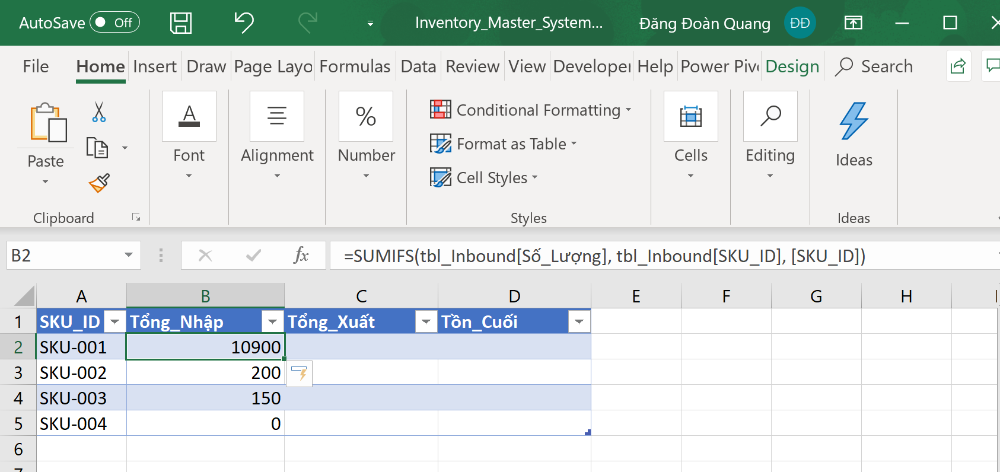
  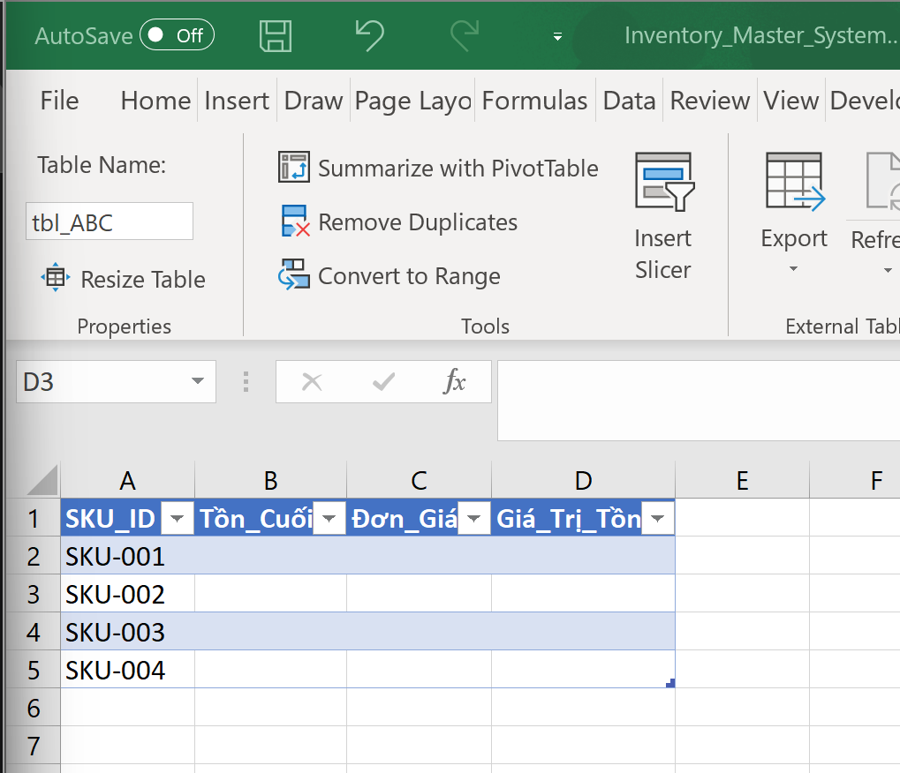
  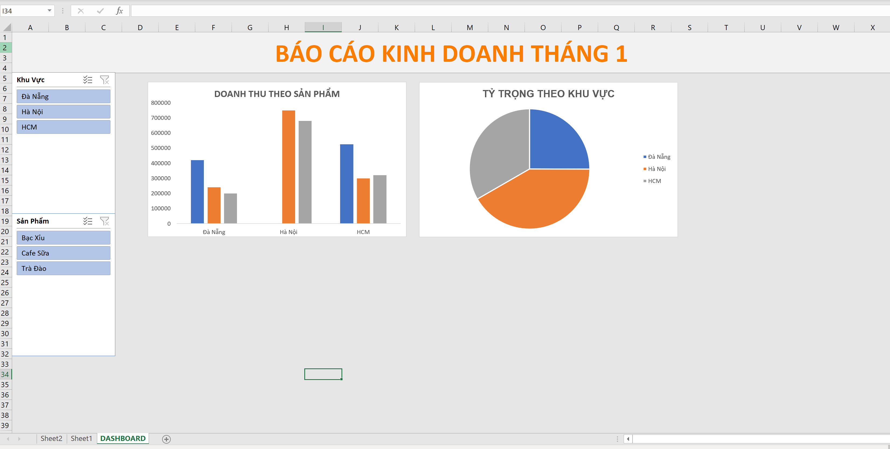

---

### 2. Metro Line 2 Survey Auditing & 26-Station Automated GIS Reporting (`02-Metro-Line2-GIS-Survey-Automation`)
Developed for **MIT Engineering & Technology Development Consulting JSC**:
- **`pwa-survey-auditor/`**: Offline-first Progressive Web App auditing **1,000+ passenger interviews** and modeling modal-shift probability across **63 fare & travel-time scenarios**.
- **`gis-report-engine/`**: Python automation pipeline reconciling Excel Origin-Destination (O-D) matrices with `.kmz` coordinates, generating 5 spatial buffer maps per station (200m/500m/1000m rings, 24 bus stops, PUDO zones), and compiling **26 standardized 30+ page Word reports (ST01–ST26)**.

  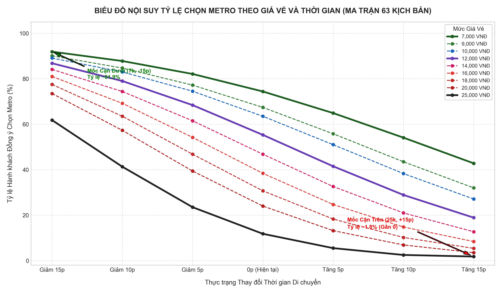
  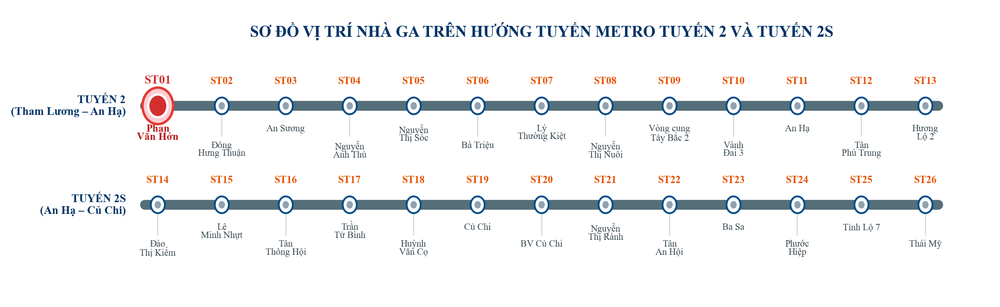
  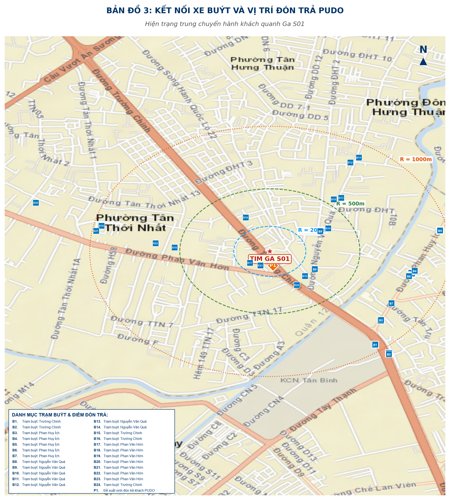

---

### 3. Published CFS Warehouse & Container Terminal Simulation (`03-AnyLogic-CFS-Port-Digital-Twin`)
- **Paper 1 (Published in JTST — Grant `KHSV2514/HD-UTH`):** *Optimizing Material Handling Vehicles in CFS Warehouses Using Simulation* ([Read Paper](https://jtst.ut.edu.vn/articles/6a1e8bd27dc7071ce848c1b8)). Validated at **MAPE = 3.04%** across 5 dock doors (270 LCL packages/shift) at Phu Huu CFS Warehouse (Cat Lai Port). Optimal SOP **KB4 (2 Ext – 4 Int)** reduces peak staging congestion ($Q_{\max}$) by **63.3%** and saves **356.4M VND/year**.
- **Paper 2 (`JTST-2026-1148`):** *Quay Crane (QC) & Terminal Trailer Coordination at SP-ITC International Container Terminal* (2,782 moves), proving **5 QCs + 20 Trailers** achieves an optimal **21.8-hour vessel makespan** ($U_{\text{QC}} = 85.4\%$).

  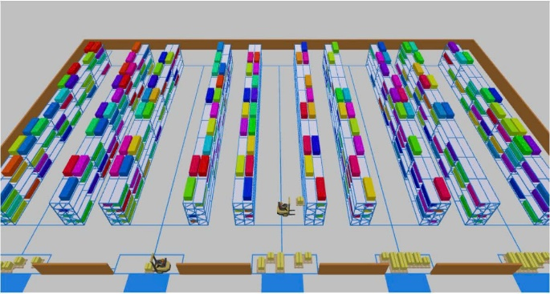
  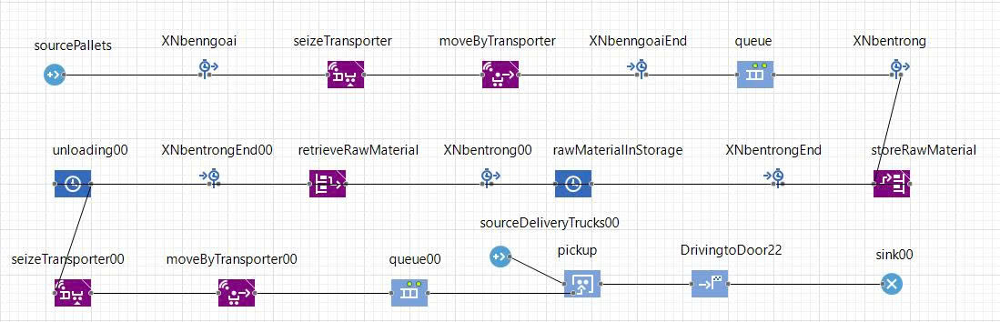
  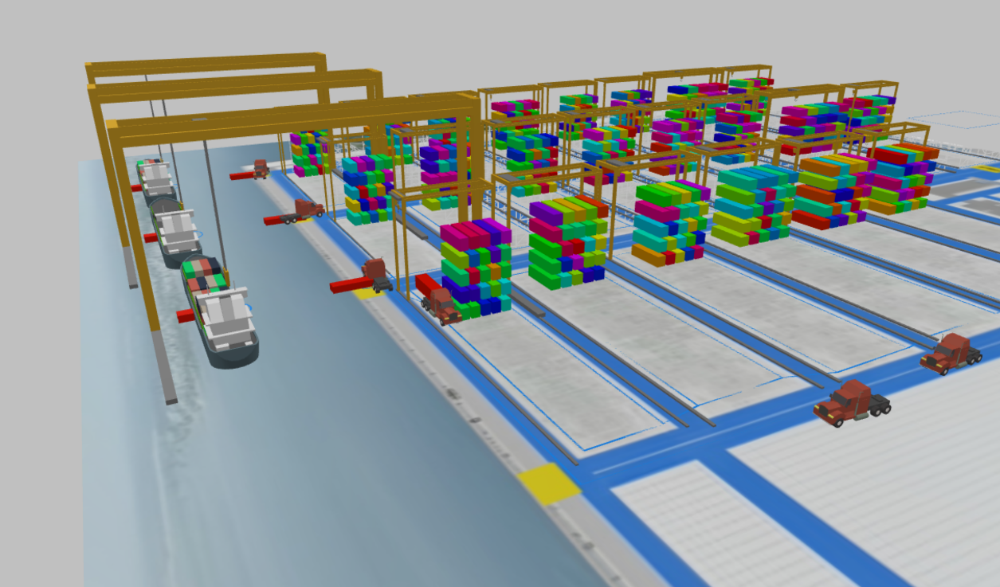
  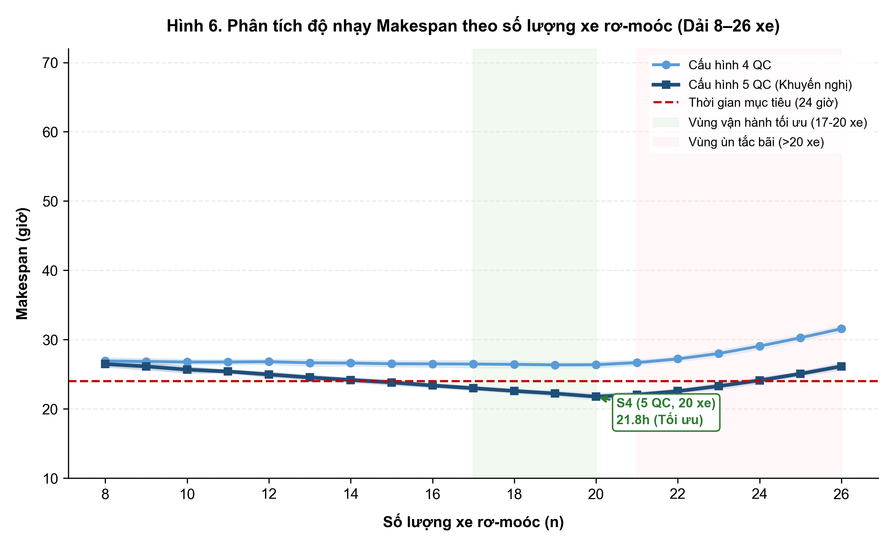

---

### 4. Cross-Departmental Complaint SOP & B2B Portfolio Governance (`04-BPO-SOP-And-B2B-Portfolio-Analytics`)
Conducted during the Enterprise Semester at **U&I Logistics Corporation**:
- Audited **15 operational SOPs** across Sales & CS, Ocean Freight, Bonded Warehousing, Customs Brokerage, and Fleet Dispatch; designed a standardized **Swimlane SOP Flowchart**, **5W1H Call Logging Protocol**, and inter-departmental SLA matrix.
- Built a **Weighted Scoring Model (WSM)** evaluating B2B client archetypes against a **1,163.52B VND** revenue baseline.

  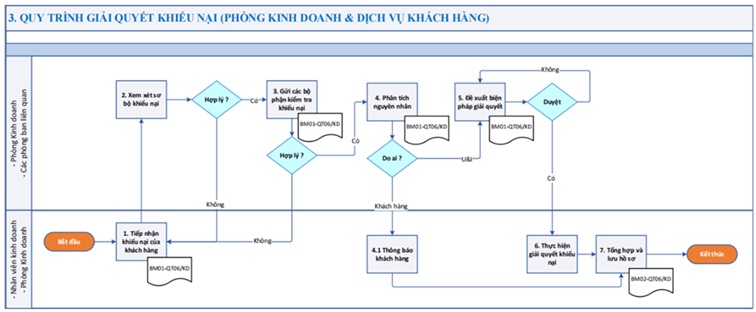
  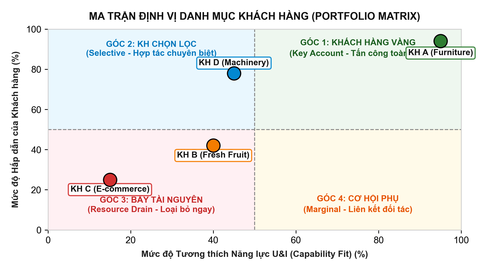
  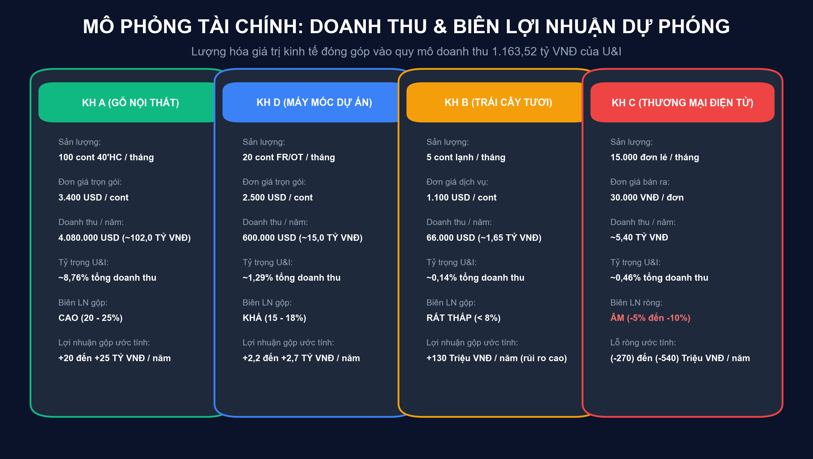
  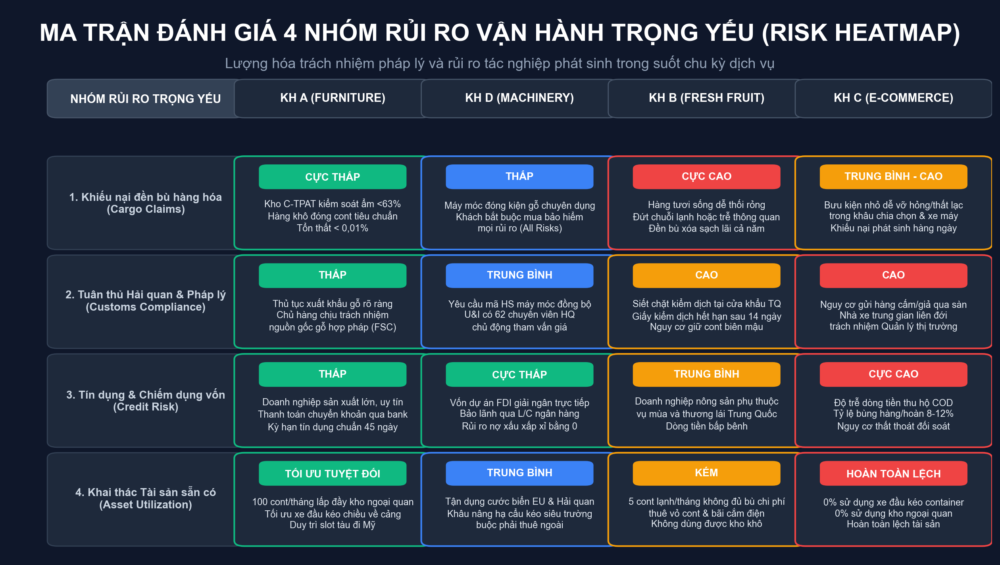

---

### 5. SCTECH Multi-Method Digital Twin Suite & AI Traffic Vision (`05` & `06`)
Reference models from the **8-Chapter "SCTECH Warehouse Simulation with AnyLogic" Course** (Global Maritime Container Fleet & Storm Disruption, Two-Terminal Airport, 3D Highway Interchange), **Toyota Milk-Run Optimizer**, **GPS Stay-Point O-D Mining**, and **YOLOv8 Traffic Counter (`appdemxe`)**.

  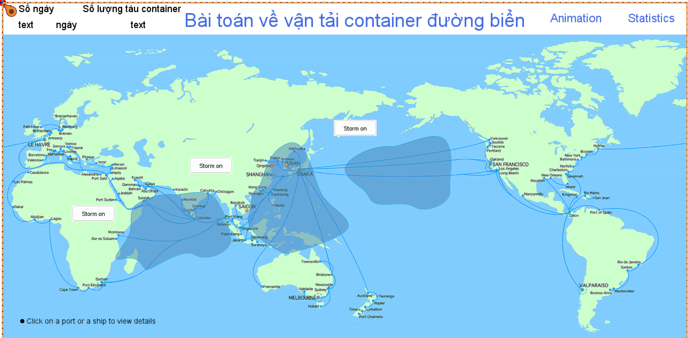
  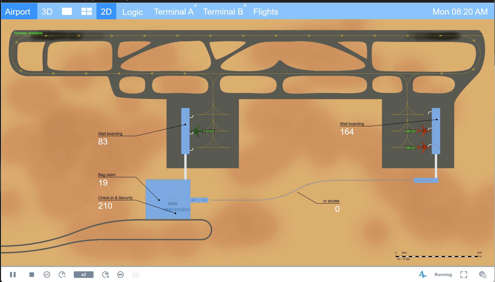
  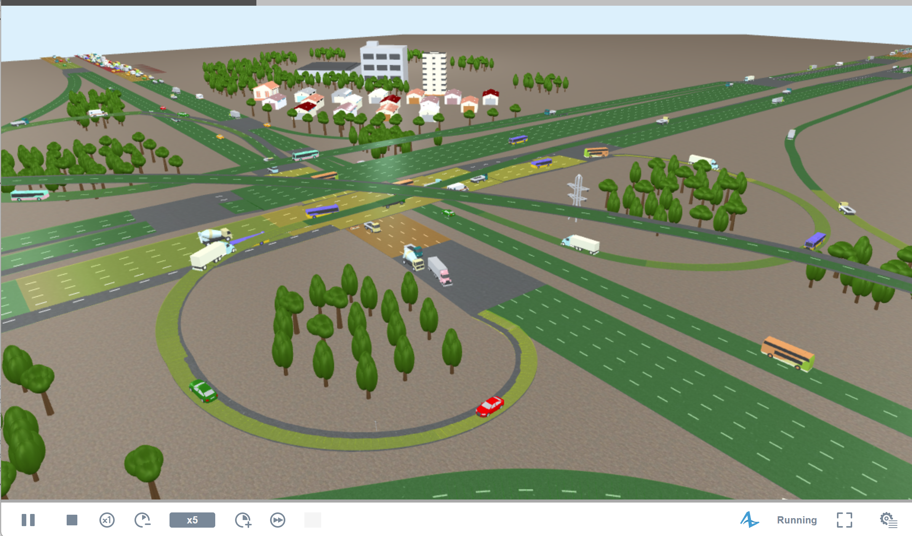

---

## 📬 Contact & Verification Links
- **Full Name:** Doan Quang Dang (Đoàn Quang Đăng)
- **Email:** [dangdoanquang2@gmail.com](mailto:dangdoanquang2@gmail.com)
- **Official Website:** [https://sctech.vn](https://sctech.vn)
- **Community & SCM 4.0 Analyses:** [https://www.facebook.com/sctech.vn](https://www.facebook.com/sctech.vn)
- **Peer-Reviewed Journal Paper (JTST):** [https://jtst.ut.edu.vn/articles/6a1e8bd27dc7071ce848c1b8](https://jtst.ut.edu.vn/articles/6a1e8bd27dc7071ce848c1b8)

